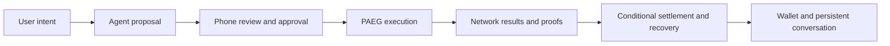

# Lianum

**One wallet. An always-on agent. Financial plans you can verify.**

Lianum combines a mobile wallet, a persistent financial agent and **PAEG — Private Atomic Execution Graphs**. A user can discuss an intent, review a concrete plan on their phone and authorize its execution across supported networks and DeFi venues. The agent proposes; the device owns approval; the engine tracks execution, evidence and settlement.

The project connects the conversational experience to the hard financial infrastructure underneath it: private notes, proof workers, heterogeneous chain adapters, explicit executor compensation and recovery after uncertain outcomes.

## What makes it interesting

- **A plan is more than a list of transactions.** PAEG carries dependencies, budgets, validity windows and settlement conditions through preparation, authorization and execution.
- **The agent stays with the user.** Durable chat, streaming responses, voice, explicit memory, scheduled followups, operation observation and notifications share one owner-scoped service.
- **Authority stays separate from intelligence.** The agent has a proposer identity. Wallet keys and financial approval remain on the device; a conversation is not a spending authorization.
- **Private execution has a real proof pipeline.** The repository contains circuits, authenticated cryptographic artifacts, proof workers, verifier consumers and integration tests that produce genuine proofs.
- **Recovery is part of the design.** Durable journals preserve accepted operation identities. Lost responses are reconciled, while anchored caching and RPC batching reduce repeated historical reads.
- **One mobile experience spans different financial models.** Native ETH, BTC and SOL wallet flows sit alongside private plans and supported Uniswap, Aave and Morpho paths, with explicit Mainnet/Testnet context.

## Follow one plan



PAEG's atomicity concerns conditional economic settlement. It does not roll back transactions already confirmed on independent chains. [The execution model](docs/FINANCIAL-EXECUTION.md) explains that boundary.

## Explore the engineering

| Start here | Then go deeper |
| --- | --- |
| [Architecture](docs/ARCHITECTURE.md) | [Modules and ownership](docs/MODULES.md), [repository map](docs/STRUCTURE.md) |
| [Financial execution](docs/FINANCIAL-EXECUTION.md) | [API and SDK](docs/reference/product-api.md), [engine](packages/engine/README.md) |
| [Persistent agent](services/agent/README.md) | [Agent domain](packages/agent/src), [mobile conversation](apps/mobile/src/screens/WalletAgentScreen.tsx) |
| [Security and privacy](docs/PRIVACY-AND-OPERATIONS.md) | [Source generations and retained artifacts](docs/SOURCE-GENERATIONS.md) |
| [Validation and evidence](docs/VALIDATION.md) | [Machine-readable results](docs/submission/execution-evidence.json), [current status](STATUS.md) |
| [Development workflow](docs/WORKFLOW.md) | [Command reference](docs/COMMANDS.md), [mobile build](apps/mobile/README.md) |

The complete [documentation index](docs/README.md) provides a short reading route without discarding the implementation detail.

## Evidence you can inspect

| Demonstration | Recorded result | Scope |
| --- | --- | --- |
| ETH, BTC and SOL wallet transfers | Three confirmed native self-transfers, with public transaction identifiers | Physical phone and public testnets; not PAEG or agent initiation |
| Mixed financial graph | Four nodes, Uniswap plus three native deliveries, **21 genuine proofs**, five withdrawals | Local synthetic networks using the real SDK, custody, proof pipeline and consumers |
| Settlement accounting | 600 deposited units, 200 returned as change, 400 paid to four executors; final held/backed amounts zero | The recorded local integration generation |
| Component verification | Focused suites for recovery, native operations, mobile behavior, DeFi and startup caching | Exact suite results and limits in [validation](docs/VALIDATION.md) |

Full public-testnet PAEG and DeFi acceptance remains tracked separately. The repository does not claim an external security audit or production-wide mainnet readiness.

## Start developing

On Linux/WSL x64 with Git and Python 3.12+:

```sh
./dev prepare host
./dev status
./dev check
./dev workflows
```

`prepare host` installs or verifies the pinned Node toolchain. `check` runs the bounded repository checks; it does not start a financial engine or broadcast transactions. Network/proof laboratories need their declared resources and profiles. A source clone alone does not contain private runtime state or every retained cryptographic resource.

```sh
# Mobile development
./dev prepare mobile
./dev npm --prefix apps/mobile run typecheck

# Agent service setup and configuration
./dev npm --prefix services/agent ci --ignore-scripts
cp services/agent/.env.example services/agent/.env
```

Follow the [mobile guide](apps/mobile/README.md), [agent setup](services/agent/README.md) and [engine deployment guide](infra/google-cloud/paeg-engine/README.md) for their separate run procedures. Credentials, custody, runtime databases and build outputs stay outside Git.
