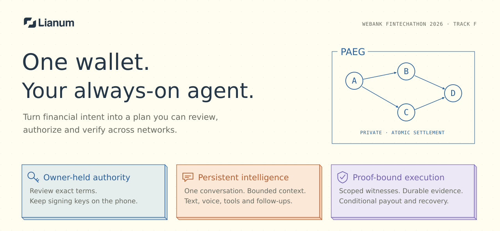
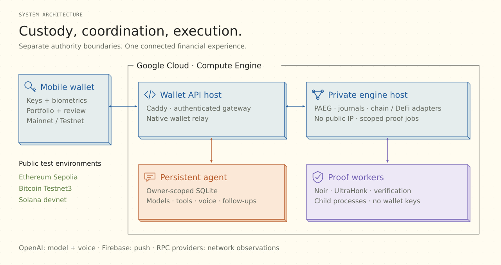
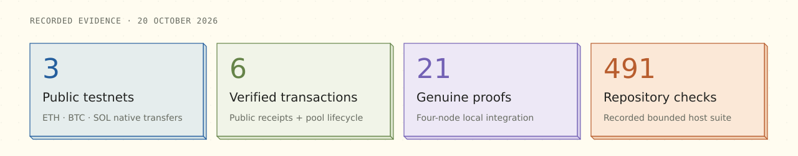

# Lianum



<p align="center">
  <a href="https://github.com/Guayamose/lianum/actions/workflows/ci.yml"></a>
  &nbsp; WeBank FinTechathon 2026 · International Track F · Agent Wallet
</p>

<p align="center">
  <a href="docs/README.md"><b>Explore the docs</b></a> ·
  <a href="docs/ARCHITECTURE.md">Architecture</a> ·
  <a href="docs/FINANCIAL-EXECUTION.md">PAEG</a> ·
  <a href="docs/AGENT.md">Agent</a> ·
  <a href="docs/PRIVACY-AND-OPERATIONS.md">Security</a> ·
  <a href="docs/VALIDATION.md">Evidence</a>
</p>

**Manage money privately, with every step under control.** Lianum brings a mobile wallet, a persistent financial agent and a verifiable execution engine into one system. Discuss a goal, review its concrete terms on your phone and authorize a plan whose dependencies, evidence and settlement rules travel together.

The engineering behind that experience is **PAEG — Private Atomic Execution Graphs**: private notes and scoped zero-knowledge proofs connect financial actions across heterogeneous networks, with explicit executor compensation and recovery accounting.

## Three ideas, one product

| Owner-held wallet | Always-on financial agent | Verifiable execution |
| --- | --- | --- |
| Portfolio, native transfers and financial review in React Native/Expo. Signing authority stays on the device. | A durable conversation with streaming, voice, tools, editable memory, follow-ups and notifications. | Graph-bound authorization, scoped proof jobs, durable operation identities and conditional settlement. |

An agent proposal becomes financial authority only after the owner reviews and signs the exact terms. PAEG's atomicity applies to economic settlement; confirmed effects on independent native chains remain final. [See the execution model →](docs/FINANCIAL-EXECUTION.md)

## Inside the system

[](docs/ARCHITECTURE.md)

The current deployment uses two Google Compute Engine hosts: the public wallet API host runs the gateway, native relay and separate agent process; the private engine host runs PAEG and its proof workers. OpenAI supplies model/voice capabilities, Firebase delivers notifications, and network adapters observe the configured chains. [Explore the deployment drawing →](docs/ARCHITECTURE.md#deployment)

## Evidence you can inspect

[](docs/VALIDATION.md)

| Evidence layer | Recorded result | Inspect |
| --- | --- | --- |
| Public testnets | Phone-originated ETH, SOL and BTC transfers; original Sepolia pool funding and owner-authorized recovery; separate DeFi execution-budget funding | [Six transaction receipts](docs/VALIDATION.md#public-transactions) |
| Genuine-proof local integration | A four-node route with Uniswap and native ETH/BTC/SOL delivery; **21 proofs**, five withdrawals and complete reserve accounting | [Campaign scope and source identity](docs/submission/execution-evidence.json) |
| Reproducible host checks | Bounded repository, component, mobile and workflow checks; CI runs from a clean checkout | [Verification guide](docs/VALIDATION.md#reproduce-the-checks) |

Public-network evidence and local integration establish different results. The [validation guide](docs/VALIDATION.md#acceptance-scope) records the demonstrated scope and the public PAEG/DeFi flows awaiting acceptance.

## Read the engineering

| Guide | What it explains |
| --- | --- |
| [Architecture](docs/ARCHITECTURE.md) | Deployment, component ownership and trust boundaries |
| [PAEG execution](docs/FINANCIAL-EXECUTION.md) | Private graphs, dependencies, proof binding, payout and recovery |
| [Persistent agent](docs/AGENT.md) | One conversation, bounded context, background work and owner approval |
| [Security and privacy](docs/PRIVACY-AND-OPERATIONS.md) | Custody, capabilities, disclosure and operational assumptions |
| [Validation](docs/VALIDATION.md) | Public receipts, local accounting and reproducible checks |
| [Development](docs/DEVELOPMENT.md) | Prepare a checkout and run the component you need |

The [documentation library](docs/README.md) connects these guides to the API/SDK, circuits, module references and deployment procedures.

## Run the first checks

On Linux/WSL x64 with Git and Python 3.12+:

```sh
./dev prepare host
./dev status
./dev check
```

The bootstrap installs or verifies pinned Node tooling. The bounded check runs without starting a financial laboratory. Follow the [development guide](docs/DEVELOPMENT.md) for mobile, agent and API setup; [laboratory profiles](docs/LAB-PROFILES.md) declare the additional resources for proof-producing and network integration runs.

---

[Product direction](PROJECT-VISION.md) · [Source map](docs/STRUCTURE.md) · [API and SDK](docs/reference/product-api.md) · [Command catalog](docs/COMMANDS.md)
