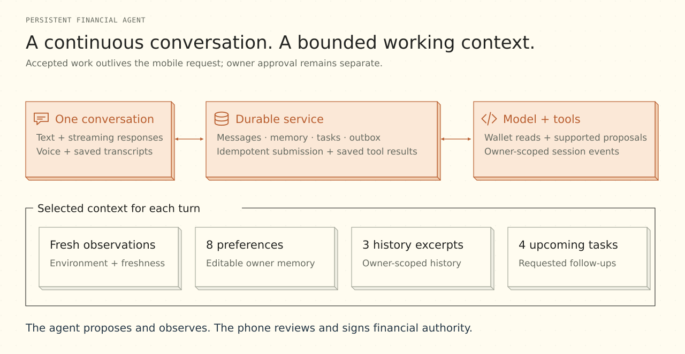

# The persistent financial agent

[Overview](../README.md) / [Documentation](README.md) / Agent

**One conversation, across sessions and interfaces.** Lianum's agent combines durable chat, streaming text, voice, explicit memory, tools and requested follow-ups. A mobile disconnect ends the subscription, while accepted server-side work retains its identity and saved result.

## A durable conversation

The independent agent service stores messages, remote session identity, preferences, tasks, tool results and notification state in owner-scoped SQLite. The gateway authenticates the device before a request enters that store. A separate proposer identity belongs to the agent; the owner's signing key stays on the phone.

Idempotent message submission prevents reconnection from becoming a second prompt. New input can steer the running session. The authenticated event stream delivers incremental text, and completed saved output remains authoritative after a disconnect.

## Context that stays bounded

Full history is persisted. The service selects a compact working reference for each queued turn:

| Context | Bound and purpose |
| --- | --- |
| Current observations | Time, language/time zone, Mainnet/Testnet environment and wallet freshness |
| Explicit preferences | Up to eight recent saved preferences, within 3,500 serialized bytes |
| Related history | Up to three excerpts, 700 characters each, retrieved from owner-scoped history |
| Upcoming work | The next four waiting follow-ups |
| Tool expansion | Bounded memory/task tools can retrieve additional relevant stored information |

Retrieval uses bounded keyword matching rather than a guarantee of semantic recall. Removing a preference deletes that active note and retains a bounded forgotten-key marker; it does not erase earlier chat or provider-side history. Follow-ups get a fresh reference when triggered.

## Wallet tools and financial authority

Wallet observations identify their source, environment, timestamp and uncertainty. With opt-in backend enrollment, the service can read registered public accounts while the phone is disconnected. A read grant is finite, scoped and independently revocable.

Supported payment tools produce **signed proposals**. The proposal still goes through mobile preparation, review and owner approval. Operation observation can report progress for an existing authorized operation; it cannot prepare, sign, send, rebroadcast or renew that payment.

## Voice and notifications

Text and in-app WebRTC voice use the same conversation and delegation boundary. Transcripts enter persistent chat; the service does not store raw call audio. Muting, hangup, heartbeat and foreground controls govern the call lifecycle.

Android push uses native Firebase Cloud Messaging. A durable outbox handles deduplication, retries and token changes. Notification payloads are generic: reply text, balances and account addresses stay outside the payload. Foreground presence and acknowledgements suppress redundant notices.

## Configuration and operations

The [service reference](../services/agent/README.md) covers local setup, gateway/backend tokens, storage modes, device allowlists, model controls, voice reservations and deployment. External provider requests and storage follow their configured retention rules; this deployment does not claim Zero Data Retention.

| Implementation | Location |
| --- | --- |
| Service process and provider adapters | [`services/agent/src`](../services/agent/src) |
| Domain, storage, context and task contracts | [`packages/agent/src`](../packages/agent/src) |
| Mobile conversation | [`WalletAgentScreen.tsx`](../apps/mobile/src/screens/WalletAgentScreen.tsx) |
| Shared proposal and review contracts | [`packages/sdk`](../packages/sdk) · [`mobile-protocol`](../packages/mobile-protocol) |

[Financial execution](FINANCIAL-EXECUTION.md) · [Security and disclosure](PRIVACY-AND-OPERATIONS.md) · [Validation scope](VALIDATION.md)
