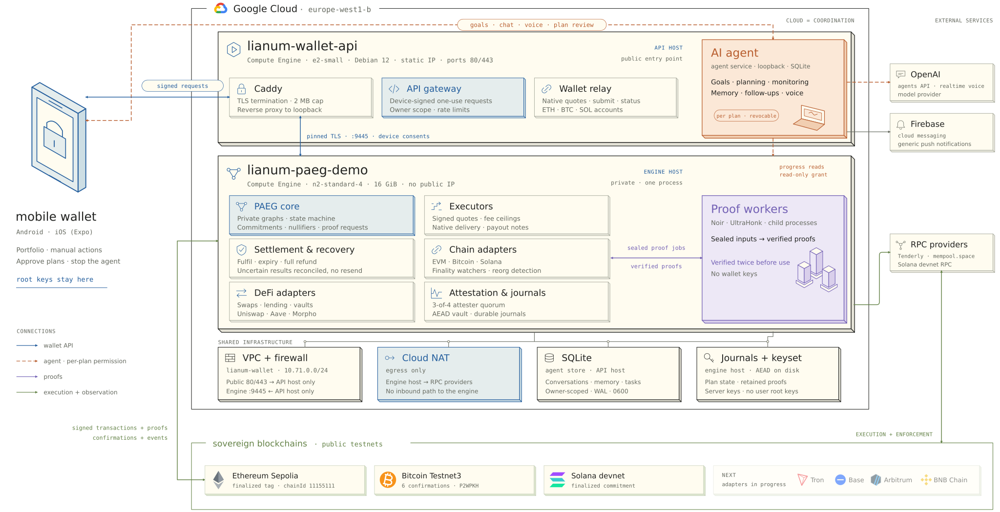

# Architecture

[Overview](../README.md) / [Documentation](README.md) / Architecture

Lianum separates **custody, coordination and execution**. The phone owns financial authority; the agent turns conversations into proposals; the gateway authenticates requests; PAEG tracks approved work, proofs and settlement.

## Deployment

The current deployment uses two **Google Compute Engine** hosts in `europe-west1-b`:

| Boundary | What runs there | What crosses it |
| --- | --- | --- |
| **Mobile wallet** | React Native/Expo UI, protected device identity, native wallet keys and review controllers | Device-signed requests, scoped consent and approved operation terms |
| **Wallet API host** | Caddy, API gateway, native wallet relay and the separate agent service | Public HTTPS; authenticated loopback service calls; restricted engine connection |
| **Private engine host** | PAEG composition, chain/DeFi adapters, journals, attestation and proof workers | Pinned TLS from the API host; outbound RPC through Cloud NAT; scoped proof jobs |
| **External services** | OpenAI model/voice, Firebase messaging and configured RPC providers | Explicit model context, generic notifications and network requests |

The engine has **no public IP**. The API and agent are separate processes on the API host, rather than independent cloud machines. Proof workers run as child processes of the engine composition.

<b>Full deployment drawing — hosts, ports, persistence and network boundaries</b>

[Open the vector drawing at full size](assets/architecture-detail.svg) · [PNG rendering](assets/architecture-detail.png)

## Mobile custody and review

The [mobile app](../apps/mobile/README.md) owns device identity, protected key storage and financial review. Sensitive actions use local authentication. Portfolio readings retain their network, freshness and uncertainty; unknown amounts stay unknown. Mainnet and Testnet contexts are explicit.

Native ETH/BTC/SOL transfers use their wallet adapters. PAEG preparation binds recipients, amounts, dependencies, validity windows and executor compensation into a plan reviewed on the device. These are separate execution paths with separate evidence.

## Durable agent coordination

The [agent service](../services/agent/README.md) owns one durable conversation per authenticated device identity, explicit preferences, follow-ups, saved tool results and a notification outbox. Accepted work continues after a mobile subscription ends; saved output is reconciled when the client reconnects.

Each turn selects bounded context from stored history and current wallet observations. Text and voice share the conversation and tool boundary. A separate proposer identity lets the agent propose supported payments while the mobile owner remains responsible for approval. [Read the agent design →](AGENT.md)

## Gateway and shared contracts

The [API service](../services/api-server/README.md) authenticates owner requests, validates scoped capabilities and routes work to the appropriate service. One-use stream authentication, bounded bodies and explicit operation identity remain part of the transport contract.

[`mobile-protocol`](../packages/mobile-protocol), [`sdk`](../packages/sdk) and the [API reference](reference/product-api.md) keep mobile and server interpretations aligned. Model keys and internal service tokens remain server-side.

## Execution, proofs and recovery

The engine combines graph execution with private accounting and heterogeneous network observations:

| Mechanism | Responsibility |
| --- | --- |
| **Graph and authority** | Bind the approved nodes, dependencies, amounts and settlement terms |
| **Private notes and commitments** | Represent reserved value and proof-bound state transitions |
| **Scoped proof workers** | Produce and verify evidence against authenticated programs, keys and ABI data |
| **Chain and DeFi adapters** | Prepare supported native/venue operations and interpret their finality |
| **Durable journals** | Preserve accepted operation identities and reconcile uncertain outcomes |
| **Anchored historical cache** | Reuse finalized public reads after checking network, genesis and block anchors |

Mutable balances, nonces and permissions still require fresh observations. Reopening a process and proving a financial flow are separate checks. [PAEG execution](FINANCIAL-EXECUTION.md) explains payout conditions and recovery.

## Source and resource boundaries

Editable packages, retained cryptographic artifacts and private runtime state have different lifecycles. Source-generation manifests identify the exact code consuming original resources; unchanged circuits can reuse their authenticated artifacts. A checkout contains neither private custody nor live financial state.

[Module ownership](MODULES.md) · [Source generations](SOURCE-GENERATIONS.md) · [Portable bundles](../packages/environment/README.md) · [Validation scope](VALIDATION.md)
