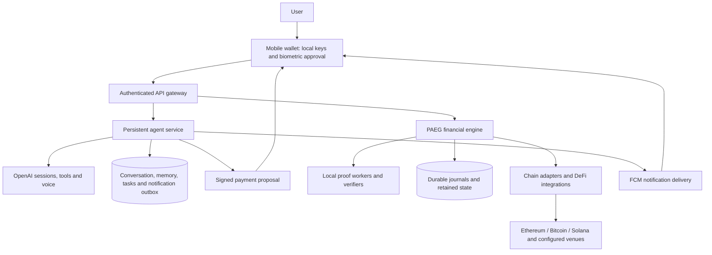

# Architecture: conversation to verifiable execution

Lianum is a full-stack agent wallet built around a strict separation of proposal, authorization and execution. Its mobile application provides one place to inspect assets, talk to an agent and review a financial plan. Independent services turn an approved plan into network operations, track their evidence and account for settlement.

## The running system

The current Google Cloud deployment uses Compute Engine VMs. The API and agent run as separate processes on the wallet API host, communicating over authenticated loopback HTTP. The PAEG engine has its own host and service. Proof workers are local child processes of the corresponding financial composition. Deployment scripts live under [`infra/google-cloud`](../infra/google-cloud).

## 1. A wallet that owns its authority

The React Native/Expo application holds the device identity and supported native wallet keys in protected device storage. Sensitive actions require local review and biometric authentication. Mainnet and Testnet environments keep their network context explicit. An unknown balance remains unknown instead of appearing as zero.

Native transfers and PAEG plans are separate execution paths. A native transfer uses the appropriate wallet adapter. A PAEG plan binds a budget, recipients, dependencies, deadlines and executor compensation into a reviewed authorization. This distinction is preserved in the UI and in the evidence: a successful SOL transfer alone does not demonstrate a cross-network plan.

## 2. An agent that can keep working

The agent service owns durable conversations, explicit preferences, scheduled followups, operation observations and notification delivery. The phone can disconnect while accepted conversational work continues. Streaming output reconnects to saved results without resubmitting the user's message.

Context is bounded. A turn receives current wallet observations and their freshness, selected preferences, related historical excerpts and upcoming tasks. Full history lives in owner-scoped storage; it is not blindly appended to every prompt. The same conversation supports text and voice. Hosted web search is configurable.

The agent has a distinct proposer identity. It can propose supported testnet payments, but it never receives the wallet's private signing key. Its proposal must pass through the mobile review and authorization path. Optional background read grants are scoped and finite. See the [agent service reference](../services/agent/README.md) for tool contracts, context limits, costs and recovery behavior.

## 3. A gateway with explicit capabilities

The public API authenticates device requests and routes them to the correct owner and service. Signed actions, one-use stream authentication, bounded bodies and scoped capabilities prevent a conversational tool from becoming a general account administrator. Shared wire types and SDK entry points reduce differences between the mobile and server interpretations of a request.

[`packages/mobile-protocol`](../packages/mobile-protocol), [`packages/sdk`](../packages/sdk) and the [API reference](reference/product-api.md) define those boundaries. Agent credentials and provider API keys remain server-side.

## 4. An engine built for difficult outcomes

PAEG—the Private Atomic Execution Graph—represents a financial workflow as nodes with explicit dependencies and evidence requirements. It connects private notes and proof-bound accounting to native delivery and supported DeFi venues. Executors are paid according to the plan's settlement rules. Retained journals preserve the identity of accepted work through timeouts, lost responses and process restarts.

The engine's complexity comes from combining heterogeneous networks, private accounting, cryptographic artifacts and recoverable execution. Its key engineering features are:

- **Proof-bound transitions:** circuit programs, verification keys, ABI data and consumers are authenticated against retained identities.
- **Explicit economic state:** reservations, delivered value, change and executor payouts have separate accounting and lifecycle rules.
- **Recovery of the same operation:** an uncertain response triggers reconciliation of the original identifier, rather than creating another payment.
- **Reusable historical reads:** finalized public RPC results can survive process restarts after their network and block anchors are revalidated.
- **Observable startup:** milestone and RPC counters expose actual progress; a milestone count is not presented as a time estimate.

See [financial execution](FINANCIAL-EXECUTION.md) for the exact meaning and limits of atomic settlement.

## 5. Libraries, artifacts and generations

The repository separates editable packages from retained cryptographic artifacts and private runtime state. Source-generation manifests identify exactly which current code consumes which original artifacts. A source change can require new pins and explicit adoption without recompiling identical circuits. Historical artifacts are verified rather than silently replaced.

The [module map](MODULES.md) describes dependency ownership; [source generations](SOURCE-GENERATIONS.md) explains reproducibility and artifact reuse. `.local` contains private state and generated evidence, while `.internal` holds restored tools and resources. Neither belongs in a public source commit.

## Validation boundary

The repository contains real proof-producing local integrations and recorded public-testnet native transfers. Their scope differs from complete public PAEG acceptance. [Validation](VALIDATION.md) records that distinction, including current gaps. Mainnet availability in the wallet is not a claim of production readiness for every financial route.
