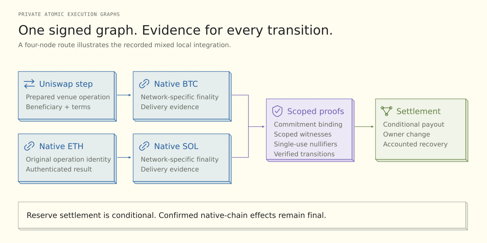

# PAEG · Private Atomic Execution Graphs

[Overview](../README.md) / [Documentation](README.md) / Financial execution

**The plan itself is a financial object.** PAEG binds a workflow's nodes, dependencies, amounts, evidence requirements and settlement rules to an owner authorization. The engine can account for the complete plan while each execution/proof role receives its relevant inputs.

## From a goal to settlement

| Stage | What becomes concrete |
| --- | --- |
| **1 · Propose** | A user or agent describes supported payments or a financial route. |
| **2 · Prepare** | The backend resolves operations, dependencies, amounts, network context, recipients and validity windows. |
| **3 · Authorize** | The phone reviews and signs the exact plan, including its budget and executor compensation. |
| **4 · Reserve and execute** | Private accounting records committed value. Dependencies gate the native or venue-specific operations. |
| **5 · Prove and reconcile** | Workers and chain readers supply the evidence required by each transition; uncertain results retain their original identity. |
| **6 · Settle or recover** | Completion follows payout/change rules. Interrupted or expired work follows its state-bound recovery route. |

An agent proposal is a proposal. Financial authority is created through the owner's review and signature, with explicit scope.

## The meaning of atomic settlement

PAEG applies **conditional economic settlement** to the graph and its private reserve. Executors receive compensation according to the signed settlement conditions. Change and recovery remain accounted for in the same lifecycle.

Independent chains have independent finality. An ETH, BTC or SOL transfer already confirmed on its network remains final even if another graph node cannot complete. PAEG recovery therefore accounts for actual effects, retained reservations, remaining value and executor terms; it does not promise cross-chain rollback.

## Proof-bound state

Commitments bind the relevant plan and private values. Scoped witnesses disclose inputs needed for a particular proof job. Authenticated programs, verification keys, ABI data and consumers determine what evidence is acceptable; single-use nullifiers prevent a private spend from being accepted twice.

The concrete circuit and consumer profiles remain explicit. A generic graph description is not proof that every adapter combination or arbitrary graph size is deployed. [Proof workers](../packages/proofs/README.md), [circuit components](../packages/components/README.md) and [source generations](SOURCE-GENERATIONS.md) describe the implementation contracts.

## Financial operation families

| Family | Implementation responsibility | Reference |
| --- | --- | --- |
| Native transfers | Device review/signing and ETH, BTC or SOL wallet adapters | [Mobile wallet](../apps/mobile/README.md) |
| Graph payments | Approved dependencies, reservation, delivery evidence and settlement | [Engine](../packages/engine/README.md) |
| Private funding and withdrawal | Source-bound notes, proof construction, nullifiers and owner recovery | [Device-authorized accounts](ORIGINAL-ACCOUNT-V2.md) |
| Uniswap | Prepared swap bound to a supported operation and beneficiary | [API/SDK](reference/product-api.md#uniswap) |
| Aave and Morpho | Position-aware investment, withdrawal preparation and mobile review | [API/SDK](reference/product-api.md#aave-and-morpho) |
| Payout and returned change | Conditional compensation and final withdrawal paths | [Validation](VALIDATION.md#local-proof-integration) |
| Stop and recover | Reconcile the same accepted work under its retained state and terms | [Account recovery](../services/api-server/docs/NATIVE-RECOVERY.md) |

The [validation matrix](VALIDATION.md#acceptance-scope) identifies the demonstrated scope of each family.

## A complete local integration

The recorded mixed campaign combined **Uniswap and native ETH/BTC/SOL delivery in four nodes**, using the actual SDK, custody, proof workers and consumers. It produced **21 genuine proofs**, including D27, and completed five withdrawals.

| Reserve accounting | Synthetic units |
| --- | ---: |
| Initial deposit | 600 |
| Returned owner change | 200 |
| Four executor payouts | 400 |
| Final held / backed | 0 / 0 |

The swap's separately received token remained unwithdrawn. These were explicit local synthetic networks; the [machine-readable campaign](submission/execution-evidence.json) preserves the source identity and that distinction from public-network acceptance.

## Uncertain outcomes and performance

A timeout or disconnected subscription does not create a second operation. The accepted identity stays in the journal until its result can be reconciled. Observation and submission are separate paths.

Startup reuses anchored finalized RPC reads, concurrent request deduplication, batching and scoped block observations. Network/genesis/finalized-block anchors are checked before reuse; mutable balances, nonces and permissions remain fresh reads. This cache does not serialize the entire live cryptographic composition or transfer acceptance between source generations.

[Backend ownership](MODULES.md) · [API/SDK contracts](reference/product-api.md) · [Engine deployment](../infra/google-cloud/paeg-engine/README.md) · [Security model](PRIVACY-AND-OPERATIONS.md)
