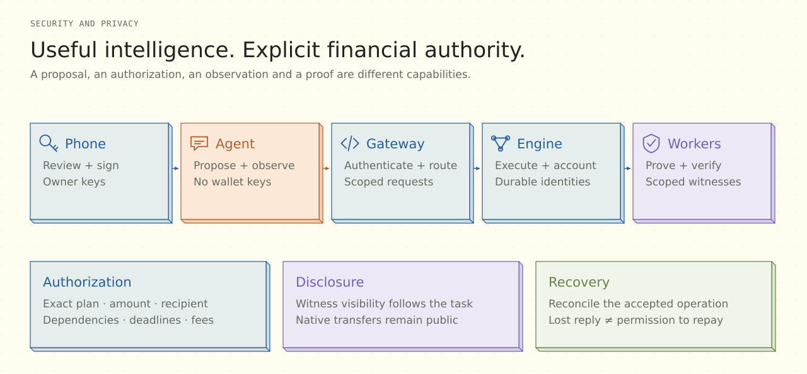

# Security and privacy

[Overview](../README.md) / [Documentation](README.md) / Security

**Separate intelligence from financial authority.** Lianum treats proposal, approval, execution, observation and proof generation as distinct capabilities across the phone, agent, gateway, engine and networks.

## Who may do what

| Principal | Capability | Boundary |
| --- | --- | --- |
| **Mobile owner** | Review and sign concrete financial terms; approve/revoke supported grants | Native keys and device identity remain in protected device storage |
| **Agent proposer** | Read permitted observations, draft supported proposals and follow authorized progress | Proposer identity and read access do not grant wallet signing authority |
| **API gateway** | Authenticate requests and enforce route-specific capabilities | Internal tokens, request limits and one-use stream authentication are separate from financial approval |
| **Financial engine** | Apply approved execution, proof, settlement and recovery rules | Operations retain their original owner, source, domain and terms |
| **Proof workers** | Prove or verify the selected transition | Jobs receive necessary witnesses; workers do not hold native wallet keys |

Authorization binds the applicable plan, recipient, amount, dependencies, deadline and executor compensation. Editing or canceling a review is distinct from approving it. Mainnet/Testnet context and observation freshness remain explicit in the UI and tool contracts.

## Disclosure follows the execution path

Private notes, commitments and proof-bound transitions limit disclosure for the relevant ledger path. Authenticated programs, keys, ABI data and consumers constrain which proof can support a transition. Scoped inputs reduce what a role needs to process.

The system still has concrete trust assumptions. RPC providers can observe requests; API and engine hosts process operation metadata; workers can access the witnesses required by their jobs. Native transfers remain publicly visible on their networks. A multi-role local composition is not evidence of independently operated parties or system-wide anonymity.

The agent persists owner-scoped history, preferences, tasks and notifications in private SQLite storage. The configured model provider processes its selected context. This deployment does not claim Zero Data Retention. Removing a saved preference does not erase earlier messages, frozen queued context or provider history.

## Recovery preserves identity

An accepted operation keeps its original identity through lost replies and process restarts. Its outcome must be reconciled before a new action is considered. A timeout, a journal entry or a submitted proof is not final confirmation.

Unknown or stale balances stay visibly uncertain. The UI does not convert unavailable prices into zero-value assets. PAEG recovery accounts for actual finalized effects and remaining value; it cannot reverse native transactions finalized on independent chains.

[Financial lifecycle →](FINANCIAL-EXECUTION.md) · [Device-authorized accounts →](ORIGINAL-ACCOUNT-V2.md)

## Operational controls

| Control | Implementation assumption |
| --- | --- |
| Network isolation | Separate API/agent and private engine hosts; engine ingress restricted to the API path |
| Service credentials | Agent/gateway/backend credentials remain server-side and separately scoped |
| Private storage | Owner-scoped databases, custody records, encrypted journals and protected key material stay outside Git |
| Notifications | Generic payloads; no balances, account addresses or reply content |
| Model spending | Explicit model/budget mode; no automatic escalation to a more expensive model or removal of a rejected cost control |
| Historical read cache | Revalidated network/block anchors; balances, nonces and permissions remain fresh reads |
| Artifact integrity | Source-generation manifests authenticate original programs, keys and retained resources |

Backups must preserve the identity and state needed by their original recovery route. A source checkout is not a custody backup; `.local` is not a disposable cache directory. See [local resources](LOCAL-ENVIRONMENT.md) and [source generations](SOURCE-GENERATIONS.md).

## Review scope

This is an engineering security model and self-assessment, not an external audit. Production expansion requires independent contract/circuit review, operational hardening, key/backup review, provider diversity and acceptance of each supported financial route. [Validation](VALIDATION.md#acceptance-scope) records the present demonstration scope.

[Architecture](ARCHITECTURE.md) · [Agent design](AGENT.md) · [Validation](VALIDATION.md) · [Engine operations](../infra/google-cloud/paeg-engine/README.md)
